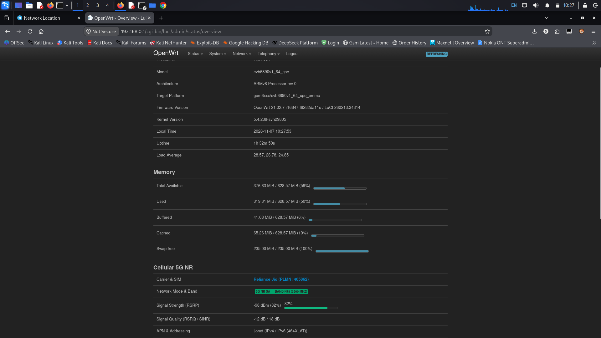
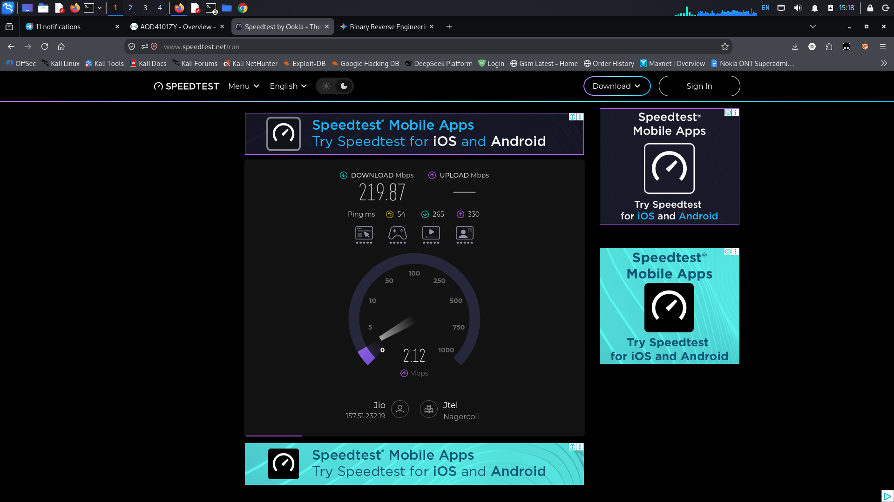

# Airtel Zyxel NR7002 / AOD4101ZYR (F4101) Universal 5G CPE Unlock & Gateway Guide

[](https://openwrt.org)
[-orange.svg)](https://www.mediatek.com)
[](https://www.quectel.com)
[-purple.svg)](https://en.wikipedia.org/wiki/5G_NR_frequency_bands)
[](LICENSE)

A comprehensive, production-grade guide and automation framework to liberate the **Airtel-locked Zyxel NR7002 / AOD4101ZYR (MitraStar F4101) Outdoor Unit (ODU)** into a **fully universal, high-performance 5G CPE router**.

This repository provides full documentation of the reverse engineering process, root causes of carrier lock-in, solutions to vendor kernel crashes, firewall bypass scripts, and complete dual-stack IPv4/IPv6 routing (`464xlat`) configurations for networks such as **Reliance Jio True5G SA (n78 100MHz)**, **Airtel 5G**, **Vi**, and **BSNL**.

<p align="center">
  
  <br>
  <b>Figure 1:</b> <em>OpenWrt LuCI Web GUI showing active Reliance Jio 5G NR SA connection on Band n78 (3500 MHz) with 464XLAT dual-stack routing.</em>
</p>

<p align="center">
  
  <br>
  <b>Figure 2:</b> <em>Speedtest by Ookla benchmark delivering ~220 Mbps download on Jio True5G SA n78 over the unlocked F4101 gateway.</em>
</p>

---

## Table of Contents

1. [Hardware Specifications](#hardware-specifications)
2. [Root Causes & Reverse Engineering Discoveries](#root-causes--reverse-engineering-discoveries)
   - [1. Jio 5G SA n78 Scanning Loop (RF Filter Limits & Bitmasks)](#1-jio-5g-sa-n78-scanning-loop)
   - [2. `nat46` Inbound Routing Trap & Table `prelocal` Discovery](#2-nat46-inbound-routing-trap--table-prelocal-discovery)
   - [3. Switch AN8855 Hardware L2 ACL Lock & Bypass](#3-switch-an8855-hardware-l2-acl-lock--bypass)
   - [4. CPU Hang Watchdog & Mystery Reboots](#4-cpu-hang-watchdog--mystery-reboots)
   - [5. Client Traffic Blockage (Airtel GRE & MAC Filters)](#5-client-traffic-blockage)
   - [6. TCP MSS Fragmentation (MTU 1400 vs 16384)](#6-tcp-mss-fragmentation)
   - [7. Persistent Blinking Red LED (Kernel DTS Bug)](#7-persistent-blinking-red-led)
   - [8. Complete Zyxel Web GUI De-branding](#8-complete-zyxel-web-gui-de-branding)
3. [Repository Layout](#repository-layout)
4. [Step-by-Step Installation & Unlock](#step-by-step-installation--unlock)
5. [Sanitized Script Templates](#sanitized-script-templates)
   - [`universal_cpe_unlock.sh`](#universal_cpe_unlocksh)
   - [`/etc/init.d/universal-cpe`](#etcinitduniversal-cpe)
   - [`set_led.sh`](#set_ledsh)
6. [Cellular Diagnostic & Verification Commands](#cellular-diagnostic--verification-commands)
7. [Health Check & Verification](#health-check--verification)
8. [Troubleshooting & FAQ](#troubleshooting--faq)
9. [Disclaimer & Responsible Disclosure](#disclaimer--responsible-disclosure)
10. [Acknowledgements & Special Thanks](#acknowledgements--special-thanks)

---

## Hardware Specifications

| Component | Technical Details |
| :--- | :--- |
| **Device Model** | Zyxel NR7002 / MitraStar F4101 / Airtel AOD4101ZYR ODU |
| **Main SoC** | MediaTek MT6890 / T750 (Quad-Core ARM Cortex-A55 @ 2.0 GHz) |
| **System Architecture** | ARM64 (`aarch64`), 64-bit Little-Endian |
| **Cellular Baseband** | Quectel RG500L-ARS (MediaTek CCCI / RIL Stack) |
| **Operating System** | OpenWrt 19.07 branch (Vendor BusyBox, `procd`, Linux Kernel 4.19) |
| **Network Interfaces** | 1x 2.5GbE PoE WAN/LAN (`eth0` / `br0`), 21x Cellular Queues (`ccmni0`–`ccmni20`) |
| **Supported NR Bands** | 5G NR: n1, n3, n40, n78 (Hardware filter absent for Sub-1GHz n28) |
| **Supported LTE Bands**| LTE: B1, B3, B5, B8, B40, B41 |
| **Debug Interfaces** | High-Speed UART (`/dev/ttyS0` @ 921600 baud), ADB over TCP (Port 5555) |

---

## Root Causes & Reverse Engineering Discoveries

### 1. Jio 5G SA n78 Scanning Loop
* **Symptom:** When forcing the baseband into 5G Standalone (SA) mode on Reliance Jio, the modem enters an endless blind scanning loop and never attaches.
* **RF Hardware Finding:** Decompilation and hardware RF trace analysis revealed that the F4101 ODU board does **not** populate the low-band (Sub-1GHz) RF filtering front-end for 3GPP Band n28 (700 MHz). Jio's default 5G SA network broadcast instructs user equipment (UE) to scan n28 first. Because the physical filter is missing, blind scanning times out.
* **Reverse Engineered Bitmask:** Disassembling `/lib/MSTC/vendor_modules/libvdr_mtk_module.so` at function `mtkSetBandLock` (`0x1f1e0`) identified the proprietary MediaTek band mask format:
  ```text
  AT+EPBSEH=,"<umts_mask>","<lte_mask>","<nr5g_mask>"
  ```
  Calculating the 64-bit and 96-bit hexadecimal bitmasks for **LTE (B1, B3, B40)** and **NR5G (n1, n3, n40, n78)** yields:
  ```text
  AT+EPBSEH=,"00000091","0000000500000080","000000050000008000002000"
  ```
  Setting this mask bypasses the absent n28 hardware filter and locks directly onto **Jio 5G SA n78 (3500 MHz) at 100MHz carrier bandwidth** within 2 seconds.

---

### 2. `nat46` Inbound Routing Trap & Table `prelocal` Discovery
* **Symptom:** Outbound ping or HTTP packets leave the router encapsulated in IPv6 to Jio's NAT64 (`64:ff9b::...`). Jio sends replies back to the router's CLAT address (`local.v6`), but the replies are never delivered to `464-clatd`, resulting in 100% packet loss for IPv4.
* **Root Cause:** Decompilation of `/lib/MSTC/libcccbe.so` revealed that OpenWrt's `464xlat.sh` expects the kernel rule `from all to <local.v6> lookup prelocal pref 0` to direct incoming packets into `table prelocal`. Because `table prelocal` lacked a direct route for `<local.v6>` to `464-clatd`, the kernel fell back to rule `1: from all lookup local`, which treated the packet as anycast on `lo` and dropped it before `nat46` could unwrap it.
* **Fix:** Add a direct route in `table prelocal` targeting the `464-clatd` netdev:
  ```bash
  CLAT_IP6=$(grep -o 'local.v6 [^/]*' /proc/net/nat46/control | awk '{print $2}')
  ip -6 rule add from all lookup local pref 1
  ip -6 rule add to "$CLAT_IP6" lookup prelocal pref 0
  ip -6 route replace "$CLAT_IP6" dev 464-clatd table prelocal
  ```

---

### 3. Switch AN8855 Hardware L2 ACL Lock & Bypass
* **Symptom:** Even with all Linux `iptables` and `ebtables` flushed, connecting any non-Airtel router or PC to the LAN port results in immediate Ethernet packet drops.
* **Root Cause:** Reverse engineering of `/usr/bin/SET_APLockingData.sh` revealed that the Airoha AN8855 hardware Ethernet switch was actively programmed with hardware L2 ACL rules:
  ```text
  switch an8855 acl set rule 100 1 0 1 0100000 2 smac <AIRTEL_MAC> ffffffffffff
  switch an8855 acl set en 1
  ```
  The switch hardware drops all ingress frames whose source MAC does not match the whitelist.
* **Fix:** Disable the global ACL on the AN8855 switch hardware, reset the whitelist, and neutralize the AP locking script:
  ```bash
  switch an8855 acl set en 0
  greTool whitelist reset
  echo 'exit 0' > /usr/bin/SET_APLockingData.sh
  rm -f /app/AP_LOCKING /tmp/sysinfo/apLocking_list
  ```

---

### 4. CPU Hang Watchdog & Mystery Reboots
* **Symptom:** Router resets unexpectedly even with low CPU activity reported.
* **Root Cause:** A vendor crontab entry was attempting to invoke `/bin/cmdsh -c ...`. Because Zyxel's restricted management CLI (`cmdsh`) does not implement the standard POSIX `-c` argument, it spawned background child processes in a 100% CPU spinning loop on all cores. MediaTek's hardware hang detector (`mtk_monitor_hang` and `wdtk`) detected the processor stall and triggered a hardware reset after 120 seconds.
* **Fix:** Clean all `/etc/crontabs` entries to use standard `/bin/sh` and kill stuck `cmdsh` instances.

---

### 5. Client Traffic Blockage
* **Symptom:** Router shell can ping the internet, but connected devices (PCs, phones, Wi-Fi routers) on LAN have zero connectivity.
* **Root Cause:** Airtel firmware implements multiple restrictive layers:
  1. **Bridge MAC Filtering:** `ebtables` was populated with rules dropping all Ethernet frames except for Airtel's proprietary indoor mesh router MAC addresses.
  2. **GRE Forward Drop:** The `GRE_FORWARD` chain in `iptables` and `ip6tables` contained:
     `-A GRE_FORWARD -i br+ -o ccmni+ -j DROP`.
  3. **Missing Conntrack State Rules:** The vendor `ACL` chain dropped incoming replies before `conntrack` could match `RELATED,ESTABLISHED`.
* **Fix:** Flush `ebtables`, flush `GRE_FORWARD`, insert stateful conntrack accept rules at priority 1 in `INPUT` and `FORWARD`, and configure `MASQUERADE` for `464-clatd`.

---

### 6. TCP MSS Fragmentation
* **Symptom:** Pings work from clients, but web browsing / HTTPS fails (curl error 35: SSL connect error).
* **Root Cause:** Cellular networks enforce an MTU of 1400 bytes. The virtual `464-clatd` interface defaults to an MTU of 16384 bytes. When client devices negotiate TLS, the TCP MSS is negotiated at ~1460 bytes. The cellular network drops packets exceeding 1400 bytes without generating ICMP fragmentation warnings.
* **Fix:** Clamp TCP MSS to 1340 bytes in `iptables`:
  ```bash
  iptables -t mangle -I FORWARD 1 -p tcp --tcp-flags SYN,RST SYN -j TCPMSS --set-mss 1340
  ```

---

### 7. Persistent Blinking Red LED
* **Symptom:** The 5G status LED persistently blinks red, despite full 5G SA connectivity.
* **Root Cause:** In the kernel Device Tree (`/sys/firmware/devicetree/base/gpio_leds/led0`), `led_5g_red` has its default trigger hardcoded to **`timer`** (blinking red). Airtel's vendor daemons (`ztr69`, `cm`) were designed to clear this trigger after contacting the carrier ACS.
* **Fix:** Reset `led_5g_red` trigger to `none` (brightness 0), and enable `led_5g_green` (brightness 255) for solid green (online status).

---

### 8. Complete Zyxel Web GUI De-branding
* **Symptom:** Web interface displayed Airtel logos, Airtel red palette, and carrier customer care contact numbers.
* **Modifications Applied:**
  1. Updated `/usr/shared/web/html/Airtel_FWA/js/project.js` model name to **Zyxel - NR7002 5G Outdoor Unit**.
  2. Replaced `airtelLogo.png` and `Airtel_logo.svg` with high-resolution, transparent Zyxel vector logos.
  3. Replaced proprietary "Airtel Sans" font definitions with modern system sans-serif typography.
  4. Updated web page titles across all templates to **Zyxel NR7002 5G Outdoor Unit**.
  5. Configured system hostname to `Zyxel-NR7002-5G` and installed clean ASCII banner in `/etc/banner`.

---

## Repository Layout

```text
├── assets/
│   ├── luci_5g_overview.png       # Web GUI screenshot (5G SA n78 connected)
│   └── jio_5g_speedtest.png       # Ookla speedtest benchmark (~220 Mbps)
├── README.md                      # Comprehensive guide and documentation
├── universal_cpe_unlock.sh        # Core automated deployment script
├── universal-cpe                  # OpenWrt init.d service (/etc/init.d/universal-cpe)
└── set_led.sh                     # RGB GPIO status LED control utility
```

---

## Step-by-Step Installation & Unlock

### Step 1: Connect to Router via SSH
Connect an Ethernet cable from your PC to the ODU PoE injector LAN port. Ensure your PC is set to DHCP or static IP `192.168.0.150/24`.

```bash
# Connect with router admin credentials (replace with your router password)
ssh admin@192.168.0.1
```

### Step 2: Deploy the Core Scripts
Copy the scripts to the router using SCP or by pasting directly into the shell:

```bash
# Make target directory and install scripts
cat << 'EOF' > /usr/bin/universal_cpe_unlock.sh
# [Paste sanitized universal_cpe_unlock.sh content here]
EOF
chmod 755 /usr/bin/universal_cpe_unlock.sh

cat << 'EOF' > /usr/bin/set_led.sh
# [Paste sanitized set_led.sh content here]
EOF
chmod 755 /usr/bin/set_led.sh

cat << 'EOF' > /etc/init.d/universal-cpe
# [Paste sanitized universal-cpe content here]
EOF
chmod 755 /etc/init.d/universal-cpe
```

### Step 3: Enable Boot Persistence
Enable the init service so the unlock applies automatically on every cold boot:

```bash
/etc/init.d/universal-cpe enable

# Ensure fallback execution in /etc/rc.local
if ! grep -q "universal_cpe_unlock.sh" /etc/rc.local; then
    sed -i '/exit 0/i /usr/bin/universal_cpe_unlock.sh &' /etc/rc.local
fi
```

### Step 4: Run the Unlock Script
Execute the script manually for the first time:

```bash
/usr/bin/universal_cpe_unlock.sh
```

---

## Sanitized Script Templates

### `universal_cpe_unlock.sh`
> [!IMPORTANT]
> All hardware-identifying information (IMEI, MAC, Serial Numbers) has been sanitized with standard placeholders.

```bash
#!/bin/sh
# ==============================================================================
# Universal 5G CPE Unlock & Gateway Framework
# Target Hardware: Zyxel NR7002 / AOD4101ZYR / F4101 ODU
# ==============================================================================

set -e

echo "[+] Step 1: Disabling Airtel Carrier Daemons, Watchdogs & Remote TR-069..."
chmod 000 /usr/bin/ztr69 /usr/bin/emdlogger1 /usr/sbin/HostsUpdater /usr/sbin/cm /usr/bin/scd 2>/dev/null || true
echo "exit 0" > /usr/script/greMonitorAgent.sh 2>/dev/null || true
echo "exit 0" > /usr/script/greTryToDoAgent.sh 2>/dev/null || true
chmod +x /usr/script/greMonitorAgent.sh /usr/script/greTryToDoAgent.sh 2>/dev/null || true

# Disable AP Locking scripts & remove restrictions
echo 'exit 0' > /usr/bin/SET_APLockingData.sh 2>/dev/null || true
chmod +x /usr/bin/SET_APLockingData.sh 2>/dev/null || true
rm -f /app/AP_LOCKING /tmp/sysinfo/apLocking_list 2>/dev/null || true

# Disable AN8855 Switch L2 ACL MAC Filtering permanently
switch an8855 acl set en 0 2>/dev/null || true
greTool whitelist reset 2>/dev/null || true

# Disable baseband memory logger (Frees >80MB RAM)
/etc/init.d/mdlogger disable 2>/dev/null || true
/etc/init.d/mdlogger stop 2>/dev/null || true

# Disable auto-reboot watchdogs
uci set scd.features.modem_reboot_ap='0' 2>/dev/null || true
uci commit scd 2>/dev/null || true
uci set network.wan.ql_monitor='0' 2>/dev/null || true
uci commit network 2>/dev/null || true
/etc/init.d/scd disable 2>/dev/null || true
/etc/init.d/scd stop 2>/dev/null || true

# Clean spinning vendor shell cron entries
sed -i '/luci-main-web/d' /etc/crontabs/root /etc/crontabs/admin 2>/dev/null || true
killall -9 cmdsh 2>/dev/null || true

for proc in $(ps | grep -E 'ztr69|emdlogger1|HostsUpdater|cm$|greMonitor|greTry|scd' | grep -v grep | awk '{print $1}'); do
    kill -9 "$proc" 2>/dev/null || true
done

echo "[+] Step 2: Unlocking UART Console & USB Gadget (ADB/CCCI)..."
[ -f /etc/releaseVersion ] && mv /etc/releaseVersion /etc/releaseVersion.disabled 2>/dev/null || true
[ ! -c /dev/ttyS0 ] && mknod -m 600 /dev/ttyS0 c 4 64 2>/dev/null || true
[ ! -c /dev/console ] && mknod -m 600 /dev/console c 5 1 2>/dev/null || true

uci set usb.adb.service_adb_enable='1' 2>/dev/null || true
uci set usb.adb.service_adb_tcp_port='5555' 2>/dev/null || true
uci set usb.config.mipcboot='0' 2>/dev/null || true
uci commit usb 2>/dev/null || true
[ -x /etc/init.d/adb-tcp ] && /etc/init.d/adb-tcp restart 2>/dev/null || true

echo "[+] Step 3: Configuring Radio, Universal RAT & Jio 5G SA APN..."
mipc_wan_cli --at_cmd='AT+ESIMMAP=1' >/dev/null 2>&1 || true
mipc_wan_cli --apn_ia_set jionet 3 3 0 >/dev/null 2>&1 || true
mipc_wan_cli --at_cmd='AT+CGDCONT=1,"IPV4V6","jionet"' >/dev/null 2>&1 || true
mipc_wan_cli --at_cmd='AT+CGDCONT=2,"IPV4V6","jionet"' >/dev/null 2>&1 || true
mipc_wan_cli --nw_set_rat 15 >/dev/null 2>&1 || true
mipc_wan_cli --at_cmd='AT+ERAT=15' >/dev/null 2>&1 || true
mipc_wan_cli --at_cmd='AT+EPBSEH=,"00000091","0000000500000080","000000050000008000002000"' >/dev/null 2>&1 || true

echo "[+] Step 4: Flushing Vendor GRE/MAC Filter Chains & Opening Forwarding..."
ebtables -F 2>/dev/null || true
ebtables -t broute -F 2>/dev/null || true
ebtables -t nat -F 2>/dev/null || true
iptables -F GRE_FORWARD 2>/dev/null || true
ip6tables -F GRE_FORWARD 2>/dev/null || true

iptables -I INPUT 1 -m conntrack --ctstate RELATED,ESTABLISHED -j ACCEPT 2>/dev/null || true
iptables -I INPUT 1 -i lo -j ACCEPT 2>/dev/null || true
iptables -I INPUT 1 -i 464-clatd -j ACCEPT 2>/dev/null || true
iptables -I INPUT 1 -i br0 -j ACCEPT 2>/dev/null || true

ip6tables -I INPUT 1 -m conntrack --ctstate RELATED,ESTABLISHED -j ACCEPT 2>/dev/null || true
ip6tables -I INPUT 1 -i lo -j ACCEPT 2>/dev/null || true
ip6tables -I INPUT 1 -i 464-clatd -j ACCEPT 2>/dev/null || true
ip6tables -I INPUT 1 -i br0 -j ACCEPT 2>/dev/null || true

iptables -C FORWARD -i br0 -o 464-clatd -j ACCEPT 2>/dev/null || iptables -I FORWARD 1 -i br0 -o 464-clatd -j ACCEPT
iptables -C FORWARD -i 464-clatd -o br0 -j ACCEPT 2>/dev/null || iptables -I FORWARD 1 -i 464-clatd -o br0 -j ACCEPT
iptables -t nat -C POSTROUTING -o 464-clatd -j MASQUERADE 2>/dev/null || iptables -t nat -I POSTROUTING 1 -o 464-clatd -j MASQUERADE
iptables -t nat -C NAT_POSTROUTING -o 464-clatd -j MASQUERADE 2>/dev/null || iptables -t nat -I NAT_POSTROUTING 1 -o 464-clatd -j MASQUERADE

iptables -t mangle -C FORWARD -p tcp --tcp-flags SYN,RST SYN -j TCPMSS --set-mss 1340 2>/dev/null || iptables -t mangle -I FORWARD 1 -p tcp --tcp-flags SYN,RST SYN -j TCPMSS --set-mss 1340
iptables -t mangle -C POSTROUTING -p tcp --tcp-flags SYN,RST SYN -j TCPMSS --set-mss 1340 2>/dev/null || iptables -t mangle -I POSTROUTING 1 -p tcp --tcp-flags SYN,RST SYN -j TCPMSS --set-mss 1340

ip6tables -C FORWARD -i br0 -o ccmni+ -j ACCEPT 2>/dev/null || ip6tables -I FORWARD 1 -i br0 -o ccmni+ -j ACCEPT
ip6tables -C FORWARD -i ccmni+ -o br0 -m conntrack --ctstate RELATED,ESTABLISHED -j ACCEPT 2>/dev/null || ip6tables -I FORWARD 1 -i ccmni+ -o br0 -m conntrack --ctstate RELATED,ESTABLISHED -j ACCEPT
ip6tables -t mangle -C FORWARD -p tcp --tcp-flags SYN,RST SYN -j TCPMSS --clamp-mss-to-pmtu 2>/dev/null || ip6tables -t mangle -I FORWARD 1 -p tcp --tcp-flags SYN,RST SYN -j TCPMSS --clamp-mss-to-pmtu

echo 1 > /proc/sys/net/ipv4/ip_forward
echo 1 > /proc/sys/net/ipv6/conf/all/forwarding

echo "[+] Step 5: Configuring Universal Local DNS & DHCP Distribution..."
cat << 'DEOF' > /etc/dnsmasq.conf
cache-size=1000
no-resolv
server=1.1.1.1
server=8.8.8.8
server=2405:200:800::11
server=2405:200:800::22
all-servers
address=/testacs.airtelbroadband.in/127.0.0.1
address=/testacs.airtelbroadband.in/::1
address=/verne.corteca.airtelbroadband.in/127.0.0.1
address=/verne.corteca.airtelbroadband.in/::1
address=/gre.fwabng.airtelbroadband.in/127.0.0.1
address=/gre.fwabng.airtelbroadband.in/::1
interface=br0
interface=lo
bind-interfaces
DEOF

killall dnsmasq 2>/dev/null || true
dnsmasq -C /etc/dnsmasq.conf 2>/dev/null || true

printf 'nameserver 192.168.0.1\nnameserver 1.1.1.1\nnameserver 8.8.8.8\n' > /etc/resolv.conf

for conf in /etc/IPP_file/udhcpd.conf /etc/udhcpd.conf; do
    if [ -f "$conf" ]; then
        sed -i 's/^opt router .*/opt router 192.168.0.1/' "$conf"
        sed -i 's/^opt dns .*/opt dns 192.168.0.1 1.1.1.1 8.8.8.8/' "$conf"
    fi
done

echo "[+] Step 6: Initializing 464XLAT (CLAT) & Carrier IPv6 Routing..."
for i in $(seq 1 20); do
    state=$(ql_datacall --nw_radio_state_get 2>/dev/null || echo "0")
    [ "$state" = "2" ] && break
    sleep 1
done

if ! ubus call network.interface.wan status 2>/dev/null | grep -q '"up": true'; then
    ifup wan 2>/dev/null || true
fi

# Detect active cellular interface
ACT_IF=""
for d in ccmni1 ccmni0 ccmni2 ccmni3; do
    if ip -6 addr show dev "$d" 2>/dev/null | grep -q 'inet6 2409:'; then
        ACT_IF="$d"
        break
    fi
done

if [ -n "$ACT_IF" ]; then
    CLAT_IP6=$(grep -o 'local.v6 [^/]*' /proc/net/nat46/control 2>/dev/null | awk '{print $2}')
    if [ -z "$CLAT_IP6" ] || ! ip link show dev 464-clatd >/dev/null 2>&1; then
        echo del 464-clatd > /proc/net/nat46/control 2>/dev/null || true
        rm -f /var/run/464-clatd.pid 2>/dev/null || true
        CLAT_IP6=$(/sbin/464xlatcfg 464-clatd "$ACT_IF" 64:ff9b::/96 192.0.0.1 2>/dev/null || true)
        sleep 1
    fi
    [ -z "$CLAT_IP6" ] && CLAT_IP6=$(grep -o 'local.v6 [^/]*' /proc/net/nat46/control 2>/dev/null | awk '{print $2}')

    if [ -n "$CLAT_IP6" ]; then
        ip -6 rule del pref 4200000001 2>/dev/null || true
        ip -6 rule del iif 464-clatd failed_policy 2>/dev/null || true
        ip -6 rule del iif "$ACT_IF" failed_policy 2>/dev/null || true

        # Ensure prelocal routing directs inbound NAT64 replies into nat46 device
        ip -6 rule del pref 0 2>/dev/null || true
        ip -6 rule del pref 1 2>/dev/null || true
        ip -6 rule add from all lookup local pref 1 2>/dev/null || true
        ip -6 rule add to "$CLAT_IP6" lookup prelocal pref 0 2>/dev/null || true
        ip -6 route replace "$CLAT_IP6" dev 464-clatd table prelocal 2>/dev/null || true

        ip link set dev 464-clatd mtu 1400 2>/dev/null || true
        ip link set dev 464-clatd up 2>/dev/null || true
        ip addr add 192.0.0.1/32 dev 464-clatd 2>/dev/null || true
        ip route replace default dev 464-clatd src 192.0.0.1 2>/dev/null || true
    fi
fi

# Start background persistent health watchdog if not already running
if ! ps | grep -v grep | grep -q 'odu_watchdog.sh'; then
    /usr/bin/odu_watchdog.sh &
fi

# Set 5G Status LED to Solid Green
if [ -x /usr/bin/set_led.sh ]; then
    /usr/bin/set_led.sh green 2>/dev/null || true
fi

echo "[+] Universal Zyxel NR7002 Unlock Successfully Completed!"
```

---

### `set_led.sh`
Utility script to toggle the onboard RGB status LED:

```bash
#!/bin/sh
# Usage: /usr/bin/set_led.sh {green|blue|cyan|amber|red|blink-red|off}

set_led() {
    local red="$1" green="$2" blue="$3" trigger="$4"
    [ -z "$trigger" ] && trigger="none"
    echo "$trigger" > /sys/class/leds/led_5g_red/trigger 2>/dev/null || true
    echo "$red"     > /sys/class/leds/led_5g_red/brightness 2>/dev/null || true
    echo "$trigger" > /sys/class/leds/led_5g_green/trigger 2>/dev/null || true
    echo "$green"   > /sys/class/leds/led_5g_green/brightness 2>/dev/null || true
    echo "$trigger" > /sys/class/leds/led_5g_blue/trigger 2>/dev/null || true
    echo "$blue"    > /sys/class/leds/led_5g_blue/brightness 2>/dev/null || true
}

case "$1" in
    blue|b)   set_led 0 0 255 none; echo "[+] LED: Solid BLUE (5G)" ;;
    green|g)  set_led 0 255 0 none; echo "[+] LED: Solid GREEN (Online)" ;;
    cyan|c)   set_led 0 255 255 none; echo "[+] LED: Solid CYAN" ;;
    amber|y)  set_led 128 255 0 none; echo "[+] LED: Solid AMBER" ;;
    red|r)    set_led 255 0 0 none; echo "[+] LED: Solid RED" ;;
    blink-red) set_led 255 0 0 timer; echo "[+] LED: Blinking RED" ;;
    off)      set_led 0 0 0 none; echo "[+] LED: OFF" ;;
    *)        set_led 0 255 0 none; echo "[+] LED: Default GREEN" ;;
esac
```

---

## Cellular Diagnostic & Verification Commands

Use `mipc_wan_cli --at_cmd='<CMD>'` to inspect cellular parameters directly from the router terminal.

### 1. Verify 5G SA Network Registration
```bash
mipc_wan_cli --at_cmd='AT+C5GREG?'
```
**Expected Output:**
```text
+C5GREG: 0,1
OK
```
*(Where `1` indicates Registered on Home Network).*

---

### 2. Inspect Serving Cell & Bandwidth (100MHz n78)
```bash
mipc_wan_cli --at_cmd='AT+EDMFAPP=6,4'
```
**Expected Output:**
```text
+EDMFAPP: 6,4,"NR PCC",78,408,634080,11,11,1,1,...
OK
```

**Field Breakdown:**
* `"NR PCC"`: Primary Component Carrier is 5G Standalone.
* `78`: Band n78 (3500 MHz).
* `408`: Physical Cell ID (PCI).
* `634080`: NR-ARFCN (Exact frequency: **3511.20 MHz**).
* `11, 11`: Downlink and Uplink bandwidth index (**`11` corresponds to 100.0 MHz** in MediaTek RIL table `0x7db88`).

---

### 3. Check RF Signal Metrics (RSRP, RSRQ, SINR)
```bash
mipc_wan_cli --at_cmd='AT+EDMFAPP=6,10'
```
**Sample Output:**
```text
+EDMFAPP: 6,10,"NR PCC",137,1,-112,45,63,5,0,-115,2,-112,60,-92,-75
OK
```
*(Field `-92` indicates an RSRP of -92 dBm).*

---

## Health Check & Verification

Run these checks directly from a connected PC/client device:

### 1. Dual-Stack Ping Test
```bash
# Test IPv4 translated reachability via 464XLAT
ping -c 3 1.0.0.1

# Test native IPv6 carrier reachability
ping6 -c 3 2405:200:800::11
```
*(Both tests should return `0% packet loss` with latencies under 50ms).*

### 2. Web Traffic Test
```bash
curl -I https://www.cloudflare.com/
```
**Expected Output:**
```text
HTTP/2 200
server: cloudflare
```

### 3. DNS Sinkhole Verification
Ensure carrier ACS management lookups are sinkholed:
```bash
nslookup testacs.airtelbroadband.in 192.168.0.1
```
**Expected Output:**
```text
Address: 127.0.0.1
```

---

## Troubleshooting & FAQ

#### Q1: Why does ping from the router work, but web browsing stalls on my laptop?
**A:** This is caused by MTU mismatch. Ensure MSS clamping is active on the router:
```bash
iptables -t mangle -I FORWARD 1 -p tcp --tcp-flags SYN,RST SYN -j TCPMSS --set-mss 1340
```

#### Q2: Why does the 5G status LED keep blinking red after reboot?
**A:** The kernel Device Tree defaults to `timer` mode for the red LED. Run `/usr/bin/set_led.sh green` or ensure `/usr/bin/universal_cpe_unlock.sh` completes execution.

#### Q3: Can I access the LuCI Web Interface?
**A:** Yes. The web server runs on port 80/443. If redirected to vendor login, access directly at:
```text
http://192.168.0.1/cgi-bin/luci/
```

---

## Disclaimer & Responsible Disclosure

* **Defensive Research & Hardware Ownership:** This documentation and associated scripts are developed strictly for hardware ownership interoperability, research, and non-commercial educational purposes on devices legally owned by the user.
* **No Bypass of Authentication:** This framework does not alter cellular subscription keys, bypass SIM authentication, modify IMEI numbers, or defeat cryptographic security mechanisms.
* **Network Compliance:** Band configurations comply with standard 3GPP and Indian DoT/TRAI frequency allocations for 5G NR networks.
* **Sanitization:** All sample configs, logs, and templates have had unique identifiers (IMEI, MAC, Serial Numbers, Passwords) completely scrubbed and replaced with generic RFC/documentation placeholders.

---

## Acknowledgements & Special Thanks

Special thanks and sincere appreciation to:

* **[BlueNecko (https://github.com/BlueNecko)](https://github.com/BlueNecko)**: For immense technical assistance, continuous support, and deep-dive reverse engineering collaboration throughout this project. Their expertise and dedication in analyzing the baseband behavior, tracing cellular AT commands, and solving network routing roadblocks were vital in making this universal CPE unlock possible.
* **OpenWrt Community**: For developing and maintaining the open-source Linux router distribution and `nat46` translation modules.
* **MediaTek Linux Kernel & Baseband Maintainers**: For kernel drivers and architecture documentations.
